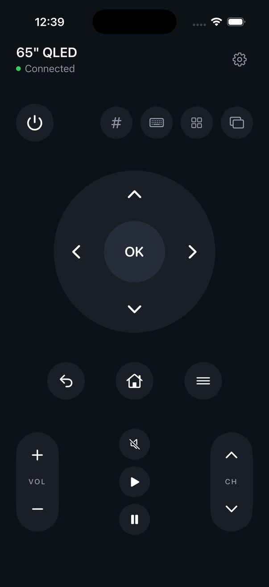
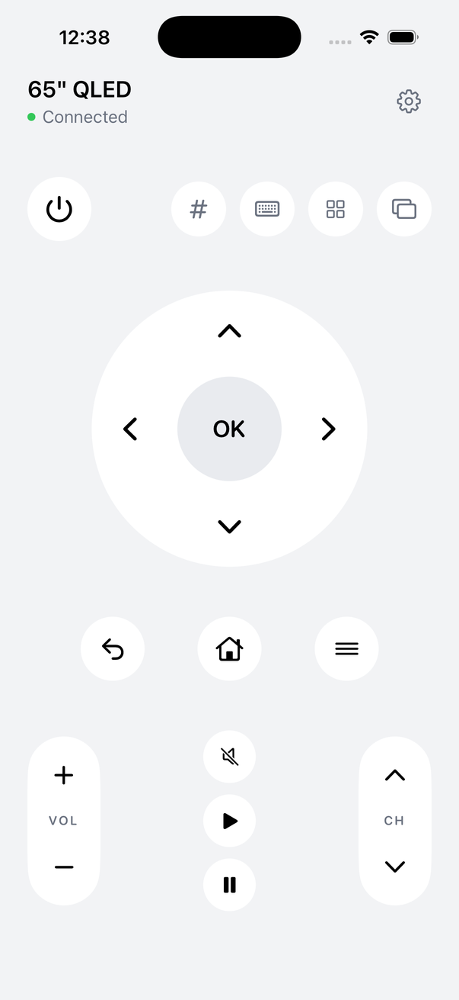
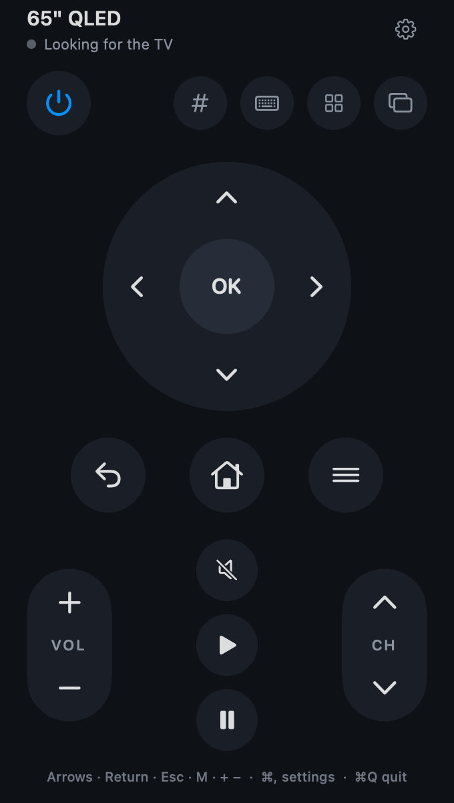

# Clicker

A remote for Samsung Smart TVs, for iPhone and the Mac menu bar. It talks to the TV directly over your home network. There's no account, no server and no cloud.

I kept losing my TV remote, so I made one that lives on devices I don't lose.

<p>
  
  
  
</p>

## What it does

- **The buttons you use**: power, a d-pad you can thumb anywhere, back, home, menu, volume and channel that repeat while held, mute, play, pause, numbers and source.
- **Typing**: send text to the TV's search box from your keyboard. The keyboard button lights up when the TV has a text field open.
- **Apps**: launch Netflix, YouTube and others on the TV.
- **Finds the TV on its own**, and follows it when its IP address changes.
- **On the Mac** it lives in the menu bar. While it's open, the arrow keys, Return, Esc, M for mute, + and − for volume, [ and ] for channel, and the digits all work.
- **Optional Home Assistant fallback** to turn the TV on with any entity that can do it, such as a smart plug or an IR blaster.

## Install

**Mac**: download `Clicker-mac.zip` from [Releases](../../releases), unzip it, move Clicker to Applications and open it. A TV icon appears in the menu bar. The app isn't notarized, so the first time macOS blocks it. Go to System Settings, Privacy & Security, and click Open Anyway. Allow Local Network access when it asks.

**iPhone**: it isn't on the App Store, so build it with Xcode, as below. With a free Apple ID, the installed app stops launching after 7 days. Reinstalling from Xcode renews it and keeps your settings.

## The first connection

The first time Clicker connects, the TV shows a prompt to allow it. Accept it with the TV's own remote, or with a USB keyboard plugged into the TV, which is how I did it. Clicker keeps the token the TV hands back, so this happens once per device. Your phone or Mac has to be on the same network as the TV.

## Build from source

You need Xcode, an iPhone on iOS 17 or later or a Mac on macOS 14 or later, and [XcodeGen](https://github.com/yonaskolb/XcodeGen).

```bash
brew install xcodegen
git clone https://github.com/dcwfz9/clicker.git
cd clicker
cp Signing.xcconfig.example Signing.xcconfig   # your team ID and a bundle ID of your own
xcodegen generate
open Clicker.xcodeproj
```

Pick the `Clicker` scheme for iPhone or `ClickerMac` for the Mac. Debug builds of the Mac app are signed to run on your Mac only and need no Apple ID.

To skip the pairing prompt on a development build, `scripts/seed.py` writes a git-ignored `Local.xcconfig` with your TV's address and an existing pairing token. Only Debug builds read it.

## How it works

- **Control**: the TV's remote-control WebSocket at `wss://<tv>:8002/api/v2/channels/samsung.remote.control`. Keys are `SendRemoteKey` messages, text is `SendInputString`, and apps launch through `ed.apps.launch`.
- **Status**: `http://<tv>:8001/api/v2/` answers in standby too, so the app can tell "standby" from "off" and read the TV's name, model, MAC address and current IP.
- **Discovery**: Samsung TVs advertise AirPlay over Bonjour. Clicker browses for it, which needs no special entitlement, and asks each result for the status URL above.
- **Power on**: a Wake-on-LAN packet first, then the power key over the paired connection while the TV is in network standby, then Home Assistant if you set it up.

## Compatibility

Tested on a 2024 Samsung QN65Q80D: pairing, keys, turning it on from standby, launching apps, and typing into the TV's search bar. It should work with Samsung TVs from 2018 on that have the network remote-control API. Older models are untested.

Not tested yet: the Home Assistant fallback.

## Privacy

Clicker talks to your TV, and to Home Assistant if you set it up. Nothing else. There's no analytics and no account. The TV's pairing token and the Home Assistant token are kept in the Keychain.

## License

MIT. See [LICENSE](LICENSE).

Built by Derek Welty with Claude Code.
